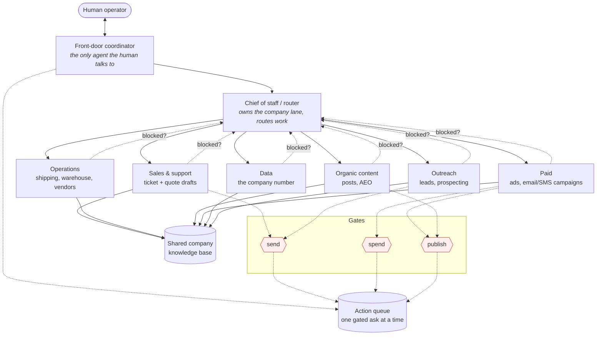

# agent-fleet

**How a 7-agent AI org runs a premium DTC brand, so that 10 employees do the work of 40.**

This is a sanitized write-up of the agent operating system I built as Chief AI Officer at a premium high-AOV Shopify brand. The fleet has 7 AI agents with hundreds of skills and numerous workflows and cron automations, covering sales/support, operations, content, data and outreach. Code, prompts and company data stay private. What's here is the **architecture and the rules that keep it safe**, plus generic skill templates you can reuse.

> One rule runs through everything: **agents draft, humans approve.** No agent sends a message, spends money, signs anything or publishes without a person saying yes.

---

## The org

| Role | Owns | Hard stop (must ask first) |
|---|---|---|
| **Front-door coordinator** | Everything the human asks for. Routes it, does small reversible tasks, runs watches | send / spend / sign / publish without the human |
| **Chief of staff / router** | All company work. Plans, splits it across specialists, verifies results, writes the morning brief | Talking to the human directly (goes through the front door) |
| **Sales & support** | Support-ticket and quote drafts, order lookups | Sending to a customer |
| **Operations** | Shipping, warehouse, vendor issues | Sending to a vendor |
| **Organic content** | Social posts, answer-engine optimization (AEO) | Publishing |
| **Paid** | Ad and email/SMS campaign drafts, performance reads | Spending, publishing |
| **Data** | One trusted company scoreboard | Spending |
| **Outreach** | Lead lists, prospecting drafts | Sending |

The 7 company agents are the chief of staff plus the six specialists. The front-door coordinator sits above them so the human has **one** conversation, not eight.

### Staffing rules

- **One front door.** Specialists ping the router when they're blocked. They never open a second line to the human.
- **Reuse before hire.** A new agent is only created after the human approves it. Every hire gets a four-line card:
  - *Owns:* the outcome nobody else owns
  - *Works from:* files, sites, accounts
  - *Done looks like:* the deliverable
  - *Never:* the one thing it must ask first
- **Small rooms.** A working channel holds the router plus at most five specialists. A heavy one-off job gets a short-lived channel, and when it closes the recipe is saved as a skill.

---

## How it works

### 1. Skills: the unit of reuse

A **skill** is a markdown file with front-matter (`name`, `description` that says *when* to use it) and a short body: steps, hard rules, and a **Never** section. The fleet has hundreds of them.

- **Rule of two:** if you're about to give an agent the same instruction a second time, write a skill instead.
- Skills are tool-agnostic and point at connectors (helpdesk, ESP, CRM, store admin, chat, docs) by role, not by credential.
- Every skill names its gate class for each action (see below).

See [`skills/`](skills/) for five generic templates.

### 2. Routines and crons

Scheduled work runs as routines: a skill plus a schedule plus a "stay quiet" rule.

- **Event listeners beat polling.** Daily is the default. Hourly only when a delay has a real cost.
- **Silence when nothing moved.** A routine that finds nothing new posts nothing.
- The router owns only two clocks (a weekday morning digest and a weekly review). Specialist clocks report into their own scoreboards.
- Typical routines: inbox triage → drafts, a stale-ticket sweep, morning metrics brief, a needs-review digest for content waiting on approval, data-cache refreshes, backups.

### 3. Ship / gate / never

Every action an agent can take falls into one of three classes:

| Class | Examples | Rule |
|---|---|---|
| **Ship** | drafts, notes, files, lookups, internal summaries | Do it. Being wrong is cheap. |
| **Gate** | anything that reaches a human outside the team, or spends money: sends, posts, ad spend, publishing | Draft it, queue it, wait for an explicit yes |
| **Never** | payments, refunds, payroll, deploys, permission changes, bulk customer-data exports | Not without a human, ever |

Before any gated action the agent writes **one pre-act line**: *what I'm about to do, why, and what should be true after.* If it can't write that line, it stops.

The front door surfaces **at most one gated ask at a time**. The rest wait in an action queue, so the human is never buried in approvals.

### 4. Approved sends go through one path

When a human has approved copy and a recipient list, the send goes through **the system's own send function**, never a hand-built API payload. A send only counts as done when the downstream system confirms delivery. A `201 Created` that's only queued doesn't count. The first hard failure stops the batch. ([template](skills/approved-send.md))

### 5. Send-identity locks

The operator works across several domains (the company, a separate business, personal). Each domain has **exactly one sending identity**, and agents may never mix them:

- Company work sends only from the company identity.
- Other businesses send only from their own identity.
- Everything else uses the personal identity.
- Company logins stay company. The shared knowledge base is company-only. Personal and side-business data never goes into it.

Mail triage checks the lock **before** it drafts anything, not after.

### 6. Memory

- **Shared company knowledge base:** one source of truth for products, policies and verified claims. One steward agent owns its health.
- **Per-agent memory:** short and factual. An agent only updates it when the current turn produced a live source.
- **Stale-fact audits:** amounts, dates, owners, statuses and logins are re-checked against a live source. Anything that wasn't checked is marked unverified and never silently "fixed". ([template](skills/stale-facts-audit.md))
- **A team file** (roster, lanes, locks, gates) is reloaded by every agent and refreshed whenever an owner or lock moves.

### 7. Cost discipline

Token waste is almost never the model. It's context bloat. So:

- Keep the front-door chat short, and send heavy work to a background worker.
- Use connectors, not screenshots. Never scrape a site page by page.
- **Budget classes:** S (inline, two or fewer tool rounds) / M (one worker) / L (browser + multi-source + multi-agent). Default is at most one L per request.
- A cheap **route decision** runs before any expensive step. ([template](skills/decide-route.md))
- Log every M/L decision in one line: `task | route | gate | budget | why`.

---

## Results

- 10 employees do the work of 40.
- 7 agents, hundreds of skills, and numerous workflows and cron automations.
- Every customer-facing send, spend and publish still has a human approval on it.

## Related

- **scottie** (private; demo on request): the fleet's content engine. Ad in, claims-gated landing and listicle pages out.

---

*Built by [Caleb Niednagel](https://github.com/clebidk). Questions: caleb.niednagel@gmail.com*
